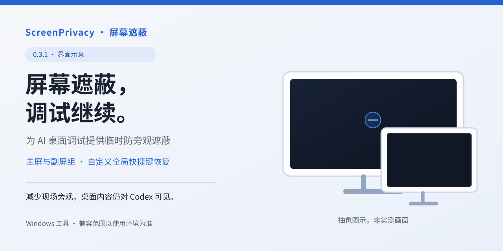
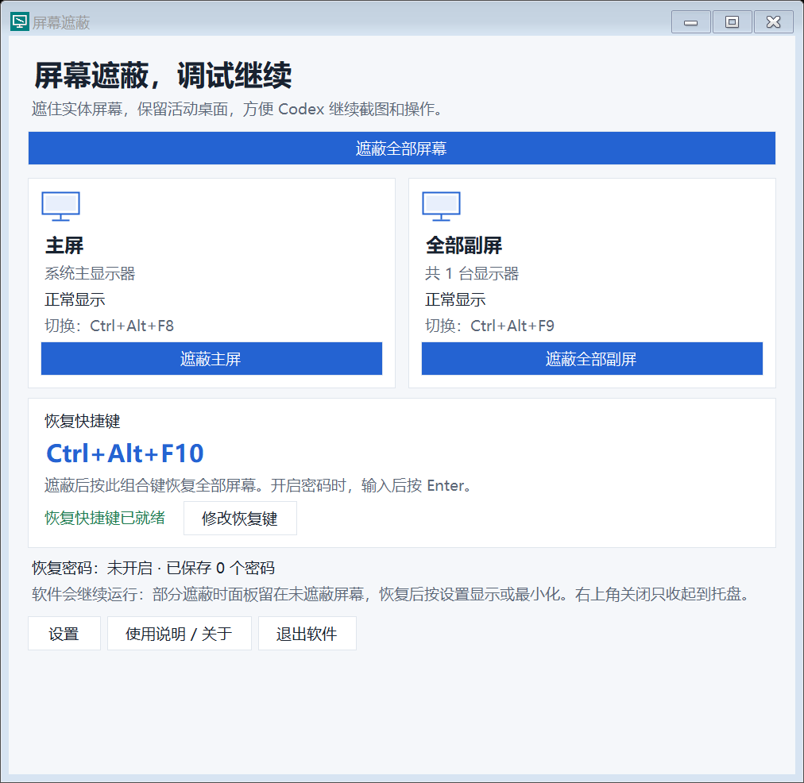
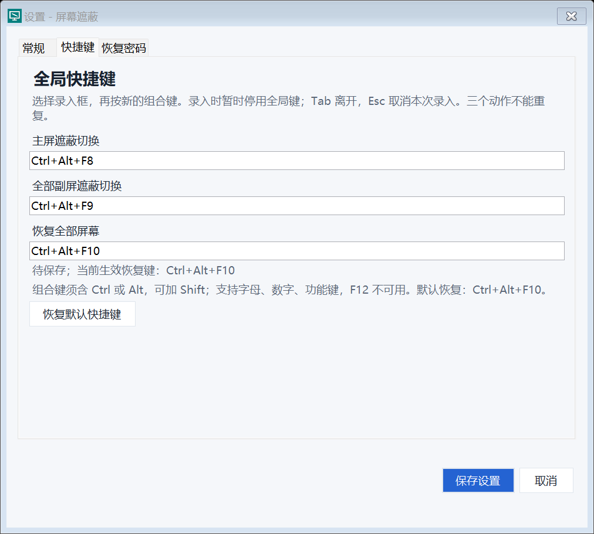

# 界面预览与演示计划

当前版本：**0.3.1**。

作者已确认本机使用检查完成。这里提供五张界面静态图和一张抽象封面，用于介绍布局与操作入口。**这些素材是界面示意，不是实体屏幕实拍或桌面操作录像。** 当前仓库没有双视角演示视频或对照图。

## 已制作素材

封面为原生 SVG 绘制，标注了“界面示意”和“抽象图示，非实测画面”。它不包含真实桌面、项目窗口或使用者信息。

以下 PNG 来自本版本的真实 WinForms 控件，使用程序自带的隐藏控件 `DrawToBitmap` 合成功能生成。使用默认合成配置，没有显示真实遮罩、填写密码或保存用户配置。图中的“恢复快捷键已就绪”属于布局样例；实际登记结果以正在运行的软件为准。

| 素材 | 内容与使用范围 |
| --- | --- |
| [主面板静态图](media/main-panel.png) | 一键全部遮蔽、主屏、全部副屏组、恢复快捷键和设置入口的布局示意。不是实体遮蔽证据。 |
| [常规设置静态图](media/settings-general.png) | 主屏样式与恢复后最小化选项；样式示意不是正在执行 Windows 更新。 |
| [快捷键设置静态图](media/settings-hotkeys.png) | 三组组合键录入入口；图示使用默认 F8/F9/F10，不是改键实测记录。 |
| [密码设置静态图](media/settings-passwords.png) | 可选验证及三个空密码槽；没有使用者的密码记录。 |
| [恢复密码窗口静态图](media/restore-password.png) | 空输入框、验证与取消入口的布局；不是完整认证流程实测。 |

主屏和全部副屏组有各自的开启入口，也可以使用“遮蔽全部屏幕”只补盖尚未遮蔽的屏幕；启动默认不遮蔽。恢复通过已保存的全局快捷键请求，Ctrl+Alt+F10 为可修改的默认值。

恢复组合键可自定义。部分遮蔽时，面板保留在或移到未遮蔽屏幕；全部遮蔽时隐藏且软件继续运行，恢复流程不依赖点击被遮住的面板或托盘。未开启最小化选项时，解除最后一块遮罩后面板自动返回原位置。

“设置 → 常规”可勾选恢复后最小化所有应用窗口，默认关闭。成功授权且将解除最后一块遮罩时，先请求普通工作窗口最小化，再恢复显示；本面板也会最小化，程序继续运行，可从任务栏或托盘唤回。取消、错误密码和只解除部分遮罩时不执行。个别不可控制窗口可能无法最小化，请求失败或超时后仍恢复显示。

素材生成范围、来源版本和 SHA-256 见 [素材来源记录](media/ASSET_PROVENANCE.json)。发行包与程序校验值见对应 Release。

## 后续可补充的双视角演示

当前仓库没有以下公开录制材料；作者确认的本机检查和可公开观看的录像分别记录：

- 外部相机连续拍摄实体显示器从正常显示、遮蔽到恢复的过程。
- 遮蔽开启后，由当前 Codex 截图通道取得的新桌面图。
- 遮蔽期间通过实际点击与输入新增唯一标记，再截图读回的证据。
- 同一轮使用已保存的自定义恢复键完成恢复的记录。
- 启用密码后的全键盘认证、错误与 Esc 取消的实际演示。

后续公开视频应使用对应发行文件，不能将其他版本的副屏观察拼作同一 EXE 的成功演示。更换捕获方式后，也应记录实际结果。

## 下一次拍摄步骤

下面是待执行分镜，不是已经拍摄的内容。先协调实体观察和录制时段，避免遮住正在使用的私人桌面。

### 拍摄准备

1. 使用该 Release 中校验值对应的 EXE，记录 Windows 构建、显示器分辨率与排列、缩放、当前 Codex 客户端和实际截图/输入通道。
2. 准备无敏感内容的记事本或测试应用。关闭私人项目、通知、账户页面和终端历史。
3. 明确本轮遮蔽目标及实际已登记的恢复组合键。主演示可关闭密码；密码分支另行拍摄。只记录密码功能是否开启，不记录任何明文或派生值。
4. 相机应拍到显示器边框和完整显示区域，从遮蔽前连续录到恢复后。检查黑屏反光，避免拍到人脸或环境中的私人文字。
5. 给本轮分配新的录制编号。唯一标记采用 `SHADE-DEMO-` 加本轮随机短码，**只在遮蔽之后通过实际界面输入**，不预填成功画面。

### 主视频分镜与字幕

时长是剪辑参考，不代表程序或 Codex 的响应速度。

| 时间参考 | 待拍画面与动作 | 本轮拍摄核对后可用字幕 |
| --- | --- | --- |
| 0–5 秒 | 相机展示未遮蔽的目标屏幕、程序主面板及本轮恢复组合键。 | 屏幕遮蔽，调试继续。 |
| 5–10 秒 | 开启目标屏幕组，部分遮蔽时记录面板仍在未遮屏；或使用一键全部遮蔽并记录面板隐藏、程序仍驻留。相机连续记录实体遮罩。 | 按主副屏分工，或一键遮蔽全部。 |
| 10–18 秒 | 保留相机连续原片；Codex 通过实际通道重新截图并识别演示窗口。 | 本轮 Codex 新截图。 |
| 18–32 秒 | Codex 点击输入区，输入遮蔽后才生成的唯一标记；如有测试按钮，再完成一次真实操作。 | 遮蔽期间继续点击与输入。 |
| 32–40 秒 | 再截图读回新标记；并列展示匹配时段的实体相机帧与 Codex 原始截图，分别标明来源。 | 新增内容，截图读回。 |
| 40–48 秒 | 确认 Codex 当前输入结束，人工按实际配置的全局恢复键。 | 按本轮已配置的恢复组合键恢复。 |
| 48–55 秒 | 主片保持最小化选项关闭，相机记录实体画面恢复、控制面板返回，并核对同一标记。 | 恢复显示，控制面板自动返回。 |

使用模拟更新样式时，紧邻画面注明“模拟画面，不执行 Windows 更新”。恢复字幕应填写本轮真实组合键；不要把默认值字幕覆盖到设置框内冒充已保存配置。

### 可选密码短片

确认 Codex 不再发送点击或键盘输入后，由人工按恢复键，使用专用合成密码完成输入和 Enter。可以先演示 Esc 取消时继续遮蔽，再重新请求恢复。相机不记录密码明文；不要声称软件会自动暂停或恢复 Codex。

### 可选最小化短片

使用两个无敏感内容的普通测试窗口，在常规页开启恢复后最小化选项。记录最后一块遮罩解除前的请求与恢复后的桌面，证明两个工作窗口和本面板都最小化，程序仍继续运行；再从任务栏或托盘唤回面板。另测取消恢复和仅解除部分遮罩不触发最小化。不要把两个测试窗口的成功写成所有系统或第三方窗口均可最小化；该选项不关闭应用，也不应靠终止进程制造效果。

### 公开剪辑规则

- 外部相机证明实体遮蔽，Codex 原始截图与动作记录证明底层新内容和操作；普通录屏不能替代相机。
- 只拼接同一构建、同一轮的材料。静态截图按静态截图标注，不伪装实时视频流。
- 保留完整相机原片与动作顺序；删去等待时注明删减，不拼出虚假的连续成功。
- 不以纯黑色块覆盖正常显示器画面，不替换测试标记、键位、时间或结果。
- 如果只有黑图、旧图或操作失败，记录实际失败并停止成功演示。不要换一个未经说明的捕获通道继续宣称原通道通过。
- 录制结束后才确认哪些产品表述得到支持，再更新 [兼容性说明](COMPATIBILITY.md)。

上述步骤是后续公开演示制作计划；现有公开素材用于界面介绍。
